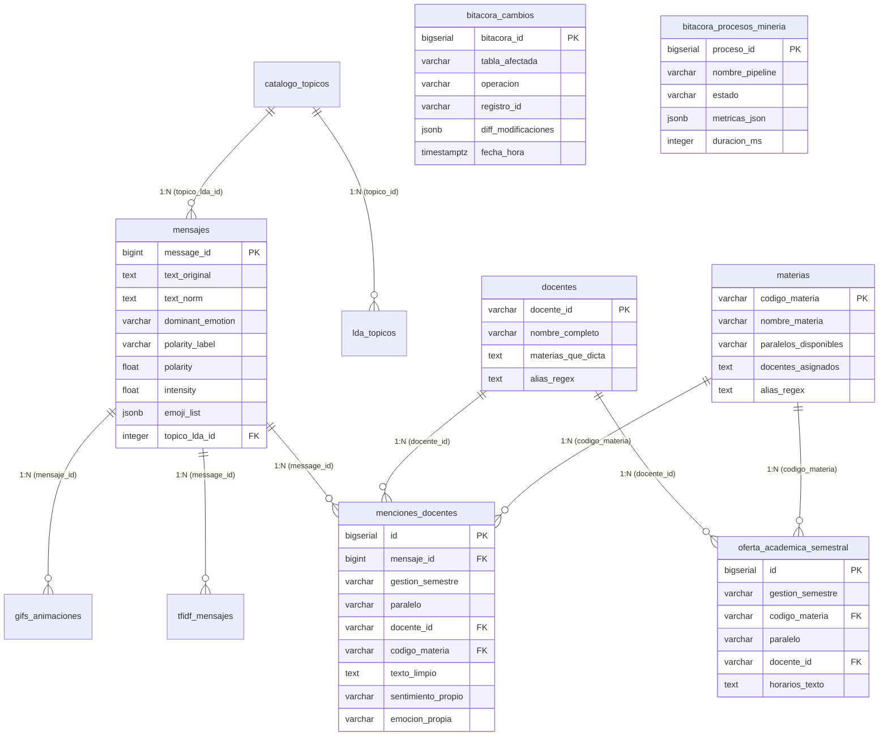

# Guía de Arquitectura, Operación y Consultas de Base de Datos (Neon PostgreSQL)
### Para Desarrolladores de Software y Agentes de Inteligencia Artificial (IA)

---

## 1. Visión General del Sistema de Base de Datos

* **Motor:** Neon Serverless PostgreSQL (versión 17.5 / 18.x compatible)
* **Región:** AWS us-east-2 (Ohio) / sa-east-1 (TGBase)
* **Protocolo:** PostgreSQL con SSL requerido (`sslmode=require`)
* **Ubicación Centralizada del Código:** Toda la lógica de base de datos reside estrictamente en [`ASDAT-253/database/`](file:///c:/Users/julio/Downloads/INF_2_2026/DM/proyUlti/ASDAT-253/database/)
* **Volumen:** Corpus central de 23,371 mensajes, 433 emojis, 12,581 tokens y 1,000 registros lingüísticos.

---

## 2. Mapa del Esquema Relacional (16 Tablas)



---

## 3. Guía de Trabajo para Desarrolladores

### 3.1. Obtención de Conexiones
Nunca hardcodear credenciales. Usar siempre el pool y contexto de conexión de `database/queries.py`:

```python
from database.queries import get_connection

with get_connection() as conn:
    with conn.cursor() as cur:
        cur.execute("SELECT COUNT(*) AS total FROM mensajes;")
        print(cur.fetchone()["total"])
    conn.commit()  # Necesario si hay escrituras
```

### 3.2. Reglas para Ingesta y Mutaciones
1. **Transaccionalidad Estricta:** Siempre englobar operaciones masivas en bloques `try ... except` con `conn.rollback()`.
2. **Uso de `executemany` o `psycopg2.extras.execute_values`:** Para insertar miles de filas, jamás hacer inserts uno a uno.
3. **Mapeo de Claves:** Si se crea una tabla nueva, asegurar que tenga clave primaria explícita (`id BIGSERIAL PRIMARY KEY` o natural `VARCHAR PRIMARY KEY`).

---

## 4. Guía y Protocolo de Operación para la Inteligencia Artificial (IA)

### 4.1. Reglas Críticas Innegociables
* **Regla 1 (Ubicación de Scripts):** Todo script de DDL, migración o consulta analítica debe crearse en `ASDAT-253/database/`. Jamás crear scripts de BD en carpetas raíz o temporales.
* **Regla 2 (No Saturar la Bitácora CDC):** No activar triggers `AFTER INSERT FOR EACH ROW` en tablas de cálculo masivo (ej: tokens, n-grams, tfidf). Las cargas batch deben registrarse como **1 fila de resumen** en `bitacora_procesos_mineria`.
* **Regla 3 (Mapeo de PKs en Triggers):** Al modificar triggers PL/pgSQL, usar resolución dinámica de clave primaria (`message_id`, `docente_id`, `codigo_materia`, `token`, `emoji`, `id`) para evitar `#null` en `registro_id`.
* **Regla 4 (Gobernanza de Datos):** Nunca ejecutar `DROP TABLE` o `TRUNCATE` en `mensajes`, `docentes` o `materias` sin confirmación previa del usuario.

### 4.2. Inyección de Contexto de Auditoría
Cuando la IA o el backend ejecuta mutaciones operativas, debe setear variables de sesión para que el trigger capture el actor:

```sql
SELECT set_config('app.current_user', 'ia_audit_agent', true);
SELECT set_config('app.current_ip', '127.0.0.1', true);
SELECT set_config('app.current_endpoint', '/api/v1/docentes/scan', true);
UPDATE mensajes SET dominant_emotion = 'alegria' WHERE message_id = 100;
```

---

## 5. Consultas SQL Canónicas para Búsqueda de Docentes y Materias

### 5.1. Búsqueda de Docentes con Expresiones Regulares en PostgreSQL (`~*`)
Dado que `catalogo_docentes_umsa.csv` incluye la columna `alias_regex` con los apodos y variaciones de nombres (ej: `\b(?:lic\.?|docente)?\s*carmen\s+huanca\b`), la consulta canónica de cruce en Neon es:

```sql
-- Buscar menciones de docentes en los comentarios reales
SELECT 
    m.message_id,
    m.timestamp_local,
    d.docente_id,
    d.nombre_completo AS docente,
    m.dominant_emotion,
    m.polarity_label,
    m.text_original
FROM mensajes m
JOIN docentes d 
  ON m.text_original ~* d.alias_regex
WHERE m.text_original IS NOT NULL
ORDER BY m.message_id ASC
LIMIT 50;
```

### 5.2. Búsqueda Cruzada de Docente y Materia Simulánea
Permite vincular si el estudiante habló del docente en el contexto de una materia específica:

```sql
SELECT 
    m.message_id,
    d.nombre_completo AS docente,
    mat.nombre_materia AS materia,
    m.dominant_emotion,
    m.polarity_label,
    m.text_original
FROM mensajes m
JOIN docentes d ON m.text_original ~* d.alias_regex
LEFT JOIN materias mat ON m.text_original ~* mat.alias_regex
ORDER BY m.message_id ASC;
```

### 5.3. Inserción Masiva Optimizada hacia `menciones_docentes`
Para materializar el cruce de datos en la tabla permanente:

```sql
INSERT INTO menciones_docentes (
    mensaje_id, docente_id, docente_mencionado, codigo_materia, materia_mencionada,
    fecha, usuario_nombre, texto_limpio, sentimiento_propio, emocion_propia
)
SELECT 
    m.message_id,
    d.docente_id,
    d.nombre_completo,
    mat.codigo_materia,
    mat.nombre_materia,
    m.timestamp_utc,
    m.sender_name,
    m.text_norm,
    m.polarity_label,
    m.dominant_emotion
FROM mensajes m
JOIN docentes d ON m.text_original ~* d.alias_regex
LEFT JOIN materias mat ON m.text_original ~* mat.alias_regex
ON CONFLICT DO NOTHING;
```

### 5.4. Ranking Emocional por Docente (Agregación para Dashboard)

```sql
SELECT 
    d.nombre_completo AS docente,
    COUNT(*) AS total_menciones,
    COUNT(*) FILTER (WHERE md.sentimiento_propio = 'positivo') AS menciones_positivas,
    COUNT(*) FILTER (WHERE md.sentimiento_propio = 'negativo') AS menciones_negativas,
    ROUND(AVG(m.polarity)::numeric, 3) AS polaridad_promedio,
    MODE() WITHIN GROUP (ORDER BY md.emocion_propia) AS emocion_predominante
FROM menciones_docentes md
JOIN docentes d ON md.docente_id = d.docente_id
JOIN mensajes m ON md.mensaje_id = m.message_id
GROUP BY d.nombre_completo
ORDER BY total_menciones DESC;
```

---

## 6. Mantenimiento y Rendimiento
* **Índices de Texto:** Se recomienda crear índices `GIN` con `pg_trgm` si el volumen de búsqueda libre aumenta:
  ```sql
  CREATE EXTENSION IF NOT EXISTS pg_trgm;
  CREATE INDEX IF NOT EXISTS idx_mensajes_text_trgm ON mensajes USING gin (text_original gin_trgm_ops);
  ```
* **Integridad Referencial:** Todas las tablas secundarias (`tfidf_mensajes`, `menciones_docentes`, `gifs_animaciones`) poseen constraints `FOREIGN KEY` con `ON DELETE CASCADE` o `ON DELETE SET NULL`.
